# Cardboard Espionage Action

A top-down stealth game where you are a cardboard box. Sneak through 10 wireframe missions past sweeping cameras, patrolling guards, drones, laser tripwires and a spinning turret. When something looks your way, hold still: it's just a box.

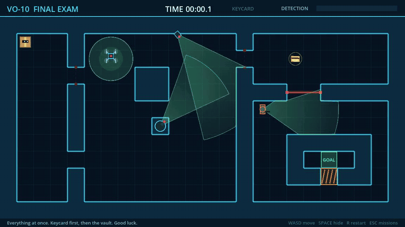

*The built-in autopilot beating the Final Exam at 2× speed. [Watch it beat all 10 missions (3½ min)](../../releases/download/v0.3.0/CardboardEspionageAction-autopilot-playthrough.mp4).*

## Play
**▶ [Play in your browser](https://ahab94.github.io/cardboard-espionage-action/)**: nothing to install. It works on phones too, with on-screen controls; hold your phone upright for the best view.

Or install the desktop version with one command:

**macOS / Linux**
```bash
curl -fsSL https://raw.githubusercontent.com/ahab94/cardboard-espionage-action/main/install.sh | bash
```

**Windows** (PowerShell)
```powershell
irm https://raw.githubusercontent.com/ahab94/cardboard-espionage-action/main/install.ps1 | iex
```

- macOS installs to `~/Applications`.
- Linux installs to `~/.local/share` and adds a `cardboard-espionage-action` command and an app-menu entry.
- Windows installs to `%LOCALAPPDATA%` and adds a Start menu shortcut.
- To uninstall on macOS/Linux, run the same command with `UNINSTALL=1` before `bash`.

You can also download the zips directly from [Releases](../../releases). The macOS app isn't notarized, so on first launch right-click → Open.

## Controls
| Key | Action |
|---|---|
| Arrows / WASD | Move |
| Hold Space (or Shift) | Hide in the box |
| R | Restart mission |
| M | Music on/off |
| Phone / tablet | Joystick (bottom-left) to move, hold HIDE (bottom-right), pause button (top-left), tap to choose missions |
| Esc | Mission select |
| Enter | Next mission / start selected |

## How stealth works
- While anything can see you, the **detection meter** fills: fast if you're moving (~⅓ s), slowly if you're a still box (~3 s). It drains when you're out of sight. Full means **ALERT**, and the mission restarts.
- **Cameras** sweep a cone that walls and pillars block. **Turrets** spin a full circle.
- **Guards** walk patrol routes and look around at each stop. If they see you moving they stop and stare. Bumping into one trips the alarm.
- **Drones** fly over walls and see everything inside their spotlight.
- **Lasers** cycle on and off and flicker just before they fire. Touching a live beam trips the alarm, even while hiding.
- **Keycards** open the orange vault doors.

## Sound
All music and sound effects are original, synthesized from scratch by [`tools/make_audio.py`](tools/make_audio.py) using Python's standard library: oscillators and noise, no samples. The music adapts as you play: a quiet stealth loop, with a synced tension layer of drums and strings that swells as the detection meter fills.

## Missions
Each mission adds one new thing. All clips show the autopilot at 2× speed.

| | |
|---|---|
| 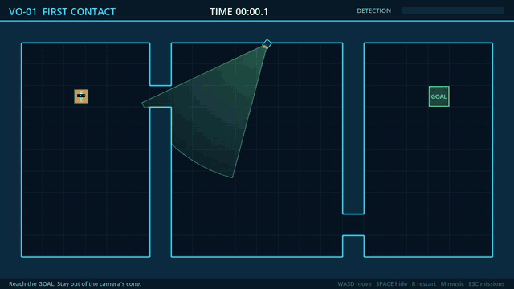<br>**VO-01 First Contact:** one sweeping camera | 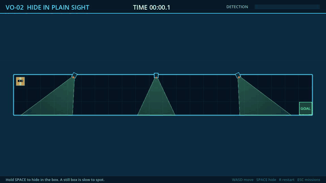<br>**VO-02 Hide in Plain Sight:** hold Space as cones pass |
| 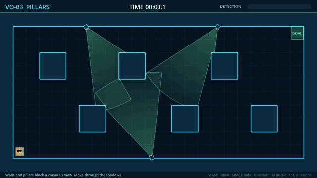<br>**VO-03 Pillars:** hide in the cameras' shadows | 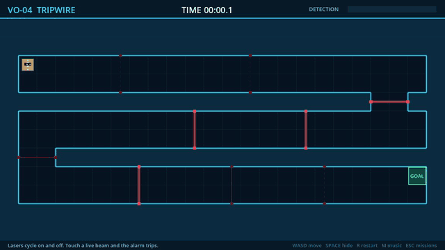<br>**VO-04 Tripwire:** time the laser waves |
| 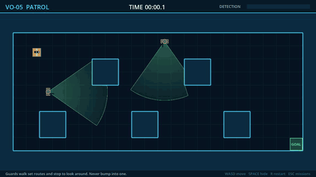<br>**VO-05 Patrol:** two guards on crossing routes | 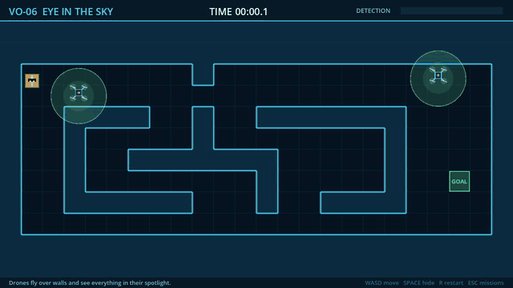<br>**VO-06 Eye in the Sky:** drones ignore walls |
| 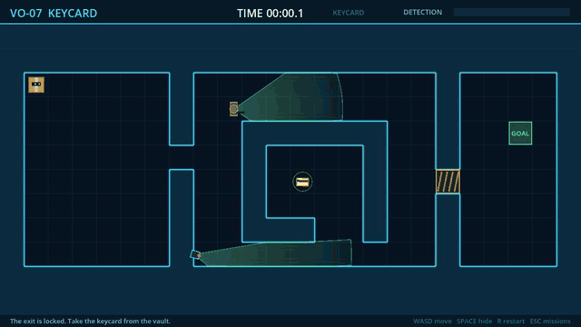<br>**VO-07 Keycard:** raid the guarded vault | 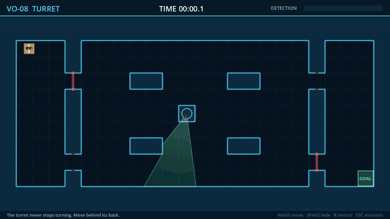<br>**VO-08 Turret:** stay behind its back |
| 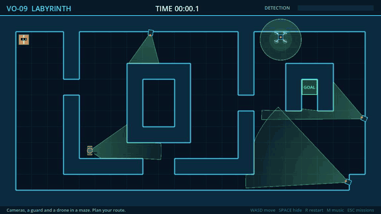<br>**VO-09 Labyrinth:** cameras, a guard and a drone | 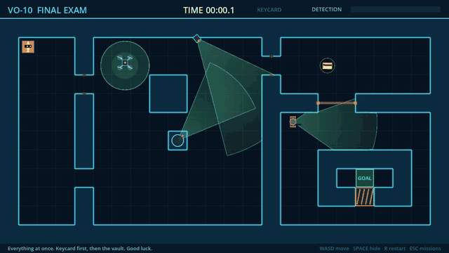<br>**VO-10 Final Exam:** everything at once |

Best times and unlocked missions are saved between sessions.

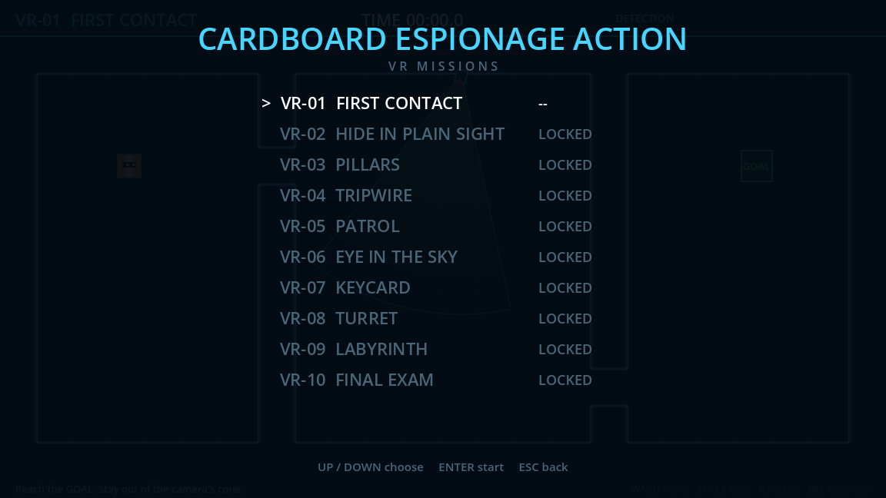

## Development
Built with [Godot 4.7](https://godotengine.org) in GDScript. There are no art assets: everything is drawn in code, and all audio is synthesized by a script.

```bash
godot --path .                 # play
bash checks/verify.sh          # tests + autopilot must beat every mission
```

- **Levels** are ASCII maps in [`scripts/levels.gd`](scripts/levels.gd). The format is documented at the top of that file.
- **Autopilot:** `godot --path . -- --level=6 --autopilot` watches a bot play. Every enemy is deterministic, so the bot forecasts camera sweeps, patrols and laser cycles, then searches over (tile, time) for a route nothing ever sees. CI runs it on every mission, so an unwinnable level fails the build.
- **Releases:** pushing a `v*` tag builds all four platforms in GitHub Actions and attaches them to a release.

## Roadmap
- [x] v0.1: sweeping cameras, box hiding, detection meter
- [x] v0.2: 10 missions, guards, drones, lasers, turrets, keycards, mission select, saves, autopilot, release builds
- [x] v0.3: original adaptive music and sound effects
- [x] v0.4: on-screen touch controls and a portrait layout for phones
- [ ] Juice: screen shake on alert, camera-spotted flash
- [ ] Noise: running is loud, creeping is quiet
- [ ] Guards that chase and search after an alert
- [ ] Larger scrolling maps and a level editor

