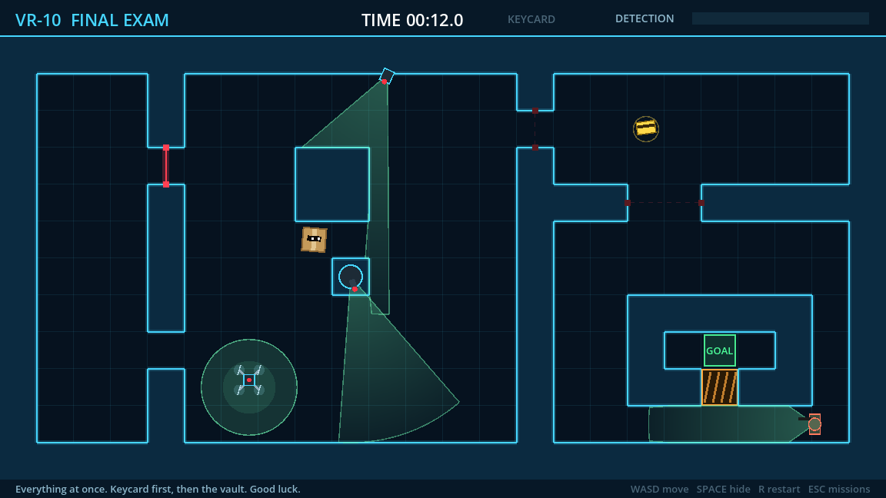
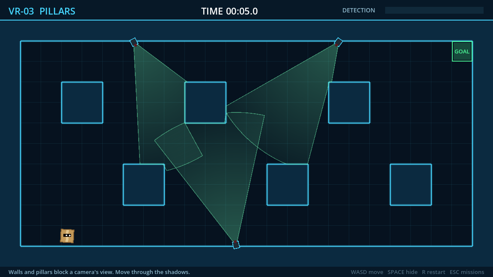
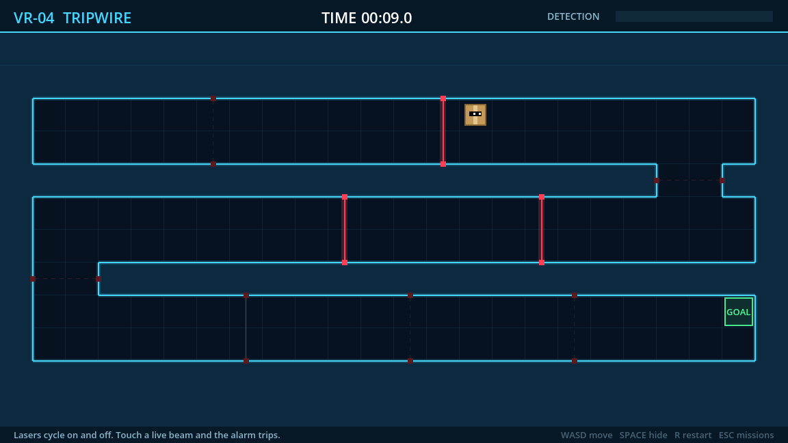
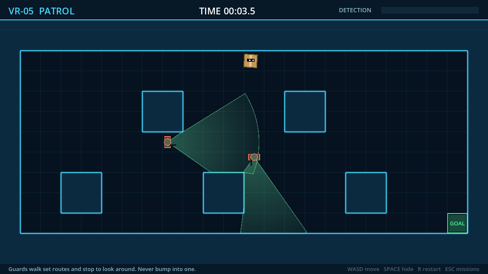
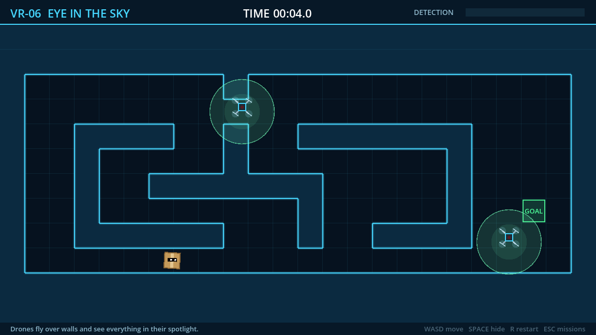
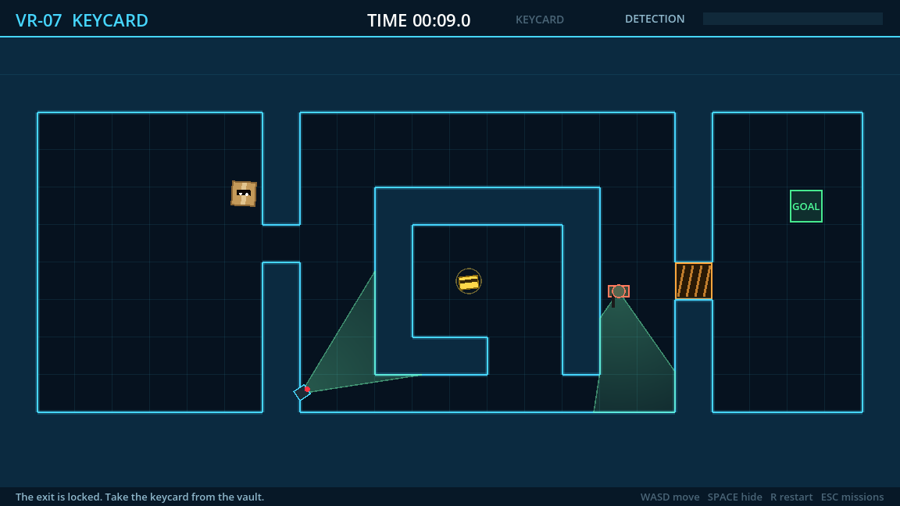
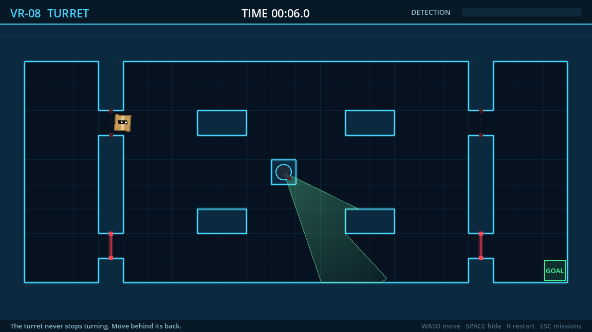

# Cardboard Espionage Action

*A tactical cardboard box game.* A top-down stealth game inspired by Metal Gear Solid's VR Missions. You are a cardboard box. Sneak through 10 wireframe missions past sweeping cameras, patrolling guards, drones, laser tripwires and a spinning turret. When something looks your way, hold still: it's just a box.



## Download
Grab the latest build for **Windows, macOS, Linux or Web** from [Releases](../../releases).

- **macOS:** the app isn't notarized. Right-click → Open the first time, or run `xattr -dr com.apple.quarantine "Cardboard Espionage Action.app"`.
- **Linux:** `chmod +x CardboardEspionageAction.x86_64` then run it.
- **Web:** serve the unzipped folder with any static web server (for example `python3 -m http.server`) and open `index.html`.

## Controls
| Key | Action |
|---|---|
| Arrows / WASD | Move |
| Hold Space (or Shift) | Hide in the box |
| R | Restart mission |
| Esc | Mission select |
| Enter | Next mission / start selected |

## How stealth works
- While anything can see you, the **detection meter** fills: fast if you're moving (~⅓ s), slowly if you're a still box (~3 s). It drains when you're out of sight. Full means **ALERT**, and the mission restarts.
- **Cameras** sweep a cone that walls and pillars block. **Turrets** spin a full circle.
- **Guards** walk patrol routes and look around at each stop. If they see you moving they stop and stare. Bumping into one trips the alarm.
- **Drones** fly over walls and see everything inside their spotlight.
- **Lasers** cycle on and off and flicker just before they fire. Touching a live beam trips the alarm, even while hiding.
- **Keycards** open the orange vault doors.

## Missions
| | | |
|---|---|---|
|  **VR-03 Pillars:** hide in the cameras' shadows |  **VR-04 Tripwire:** time the laser waves |  **VR-05 Patrol:** two guards, crossing routes |
|  **VR-06 Eye in the Sky:** drones ignore walls |  **VR-07 Keycard:** raid the guarded vault |  **VR-08 Turret:** stay behind its back |

Best times and unlocked missions are saved between sessions.


## Development
Built with [Godot 4.7](https://godotengine.org) in GDScript. There are no art assets: everything is drawn in code.

```bash
godot --path .                 # play
bash checks/verify.sh          # tests + autopilot must beat every mission
```

- **Levels** are ASCII maps in [`scripts/levels.gd`](scripts/levels.gd). The format is documented at the top of that file.
- **Autopilot:** `godot --path . -- --level=6 --autopilot` watches a bot play. Every enemy is deterministic, so the bot forecasts camera sweeps, patrols and laser cycles, then searches over (tile, time) for a route nothing ever sees. CI runs it on every mission, so an unwinnable level fails the build.
- **Releases:** pushing a `v*` tag builds all four platforms in GitHub Actions and attaches them to a release.

## Roadmap
- [x] v0.1: sweeping cameras, box hiding, detection meter
- [x] v0.2: 10 missions, guards, drones, lasers, turrets, keycards, mission select, saves, autopilot, release builds
- [ ] Sound: alert "!" sting, footsteps, laser hum
- [ ] Juice: screen shake on alert, camera-spotted flash
- [ ] Noise: running is loud, creeping is quiet
- [ ] Guards that chase and search after an alert
- [ ] Larger scrolling maps and a level editor

*A fan parody; not affiliated with Konami or Metal Gear.*
